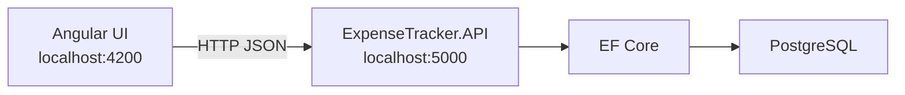
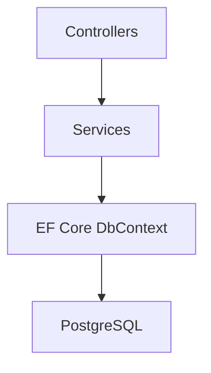

# ExpenseTracker

Personal finance tracker built as a practical full-stack portfolio project.

Angular talks to an ASP.NET Core Web API. The API uses Entity Framework Core and PostgreSQL.

This repository is being built in phases. **Phase 1 (project setup) is complete.** Authentication, expenses, and the dashboard come later.

## Current status

| Area | Status |
| --- | --- |
| Angular app | Running shell that calls the API health endpoint |
| ASP.NET Core Web API | .NET 10, controllers, Swagger |
| CORS | Allows `http://localhost:4200` |
| EF Core + PostgreSQL | Configured; connection is checked by `/api/health` |
| Tables, login, expenses | Not yet (Phase 2+) |

## Architecture





## Tech stack

- Frontend: Angular (standalone components), TypeScript, HttpClient
- Backend: ASP.NET Core Web API, .NET 10, EF Core, Swagger
- Database: PostgreSQL (pgAdmin for administration)

## Repository layout

```text
frontend/expense-tracker-ui   Angular application
backend/ExpenseTracker.API    ASP.NET Core Web API
database/                     PostgreSQL notes
docs/                         Extra documentation (later)
```

## Prerequisites

- [.NET 10 SDK](https://dotnet.microsoft.com/download/dotnet/10.0)
- Node.js 20+ (this machine used Node 24)
- Angular CLI (optional; `npx ng` also works)
- PostgreSQL 16+ (recommended)

## Configure PostgreSQL

1. Install PostgreSQL and pgAdmin.
2. Create an empty database named `expense_tracker`.
3. Put your connection string in `backend/ExpenseTracker.API/appsettings.Development.json`, **or** use user secrets so the password is not in a file:

```powershell
cd backend/ExpenseTracker.API
dotnet user-secrets set "ConnectionStrings:DefaultConnection" "Host=localhost;Port=5432;Database=expense_tracker;Username=postgres;Password=YOUR_PASSWORD"
```

See `database/README.md` for more detail.

## Run the backend

```powershell
cd backend/ExpenseTracker.API
dotnet run --launch-profile http
```

- API: http://localhost:5000
- Swagger: http://localhost:5000/swagger
- Health: http://localhost:5000/api/health

Expected health JSON includes `databaseConnected`. If it is `false`, the API still runs; fix the connection string or start PostgreSQL.

HTTPS profile (`https://localhost:5001`) is available. For the Angular app in Phase 1, HTTP on port 5000 avoids local certificate friction.

## Run migrations

Not in Phase 1. Phase 2 adds models and EF Core migrations.

## Run Angular

```powershell
cd frontend/expense-tracker-ui
npm install
npm start
```

Open http://localhost:4200. The home page calls `/api/health` and shows whether the API and database are reachable.

If Angular cannot reach the API, confirm the backend is running and that the browser console is not blocked by a CORS or HTTPS mismatch.

## API documentation

Swagger UI is enabled in Development at `/swagger`. JWT documentation will be added in the authentication phase.

## Authentication

Not implemented yet. Phase 3 adds register, login, password hashing, and JWT.

## Testing

Not implemented yet. Phase 11 adds unit tests for important business logic.

## Future improvements

- User accounts and JWT
- Expenses, categories, income, budgets
- Dashboard summaries
- Search, filters, pagination
- Export

## License

This project is for learning and portfolio use.
